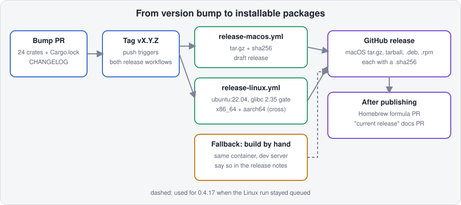

# The Linux package

The release builds one package per architecture, `fluxvm-<version>-linux-<x86_64|aarch64>.tar.gz` with a `.sha256`, from
the ubuntu:22.04 build container (`.github/workflows/release-linux.yml`). Nothing is compiled on a node: the same files
are installed everywhere, by `scripts/install.sh` today and by the `.deb`/`.rpm` (and the pull installer, as it lands) (see
the 10,000-node install plan).

## How a release becomes packages



A version-bump PR (every crate, `Cargo.lock`, the changelog) is merged, then the tag is pushed. The tag starts `release-macos.yml` (a tarball attached to a draft release) and `release-linux.yml` (the x86_64 build, and an aarch64 cross build that is still experimental, so a green run is not proof the aarch64 packages exist). Publishing is followed by the Homebrew formula PR and the "current release" docs PR.

If the Linux run cannot start, the same packages can be built by hand from the tag in the same `ubuntu:22.04` container: `scripts/package-linux.sh`, then `scripts/check-glibc-floor.sh <dir> 2.35`, then `scripts/package-linux-pkgs.sh`. For 0.4.17 the Linux x86_64 and aarch64 packages were built this way on a self-hosted server, checked (deb in Ubuntu 22.04, rpm in Fedora 43, each on its own architecture) and attached to the release, and the release notes say so.

## What is in it

`packaging/files.txt` lists every file, one per line, and `scripts/package-linux.sh` builds exactly that. It fails when a
required file is missing, so the package cannot silently lose a binary. The core group:

| Path in the package | What |
|---|---|
| `bin/fluxctl` (+ `bin/fluxvm` link) | CLI and the daemon (`fluxctl serve`) |
| `bin/fluxvm-hypervisor` | the in-tree FluxVM hypervisor |
| `bin/fluxvm-agent` | fleet central and the per-node heartbeat client |
| `bin/fluxvm-kube`, `bin/kubectl-fluxvm` | the Kubernetes operator and its kubectl plugin |
| `bin/fluxvm-microvm` | the Kubernetes MicroVM controller and node agent |
| `bin/fluxvm-guard` | VMM Guard CLI |
| `lib/bpf/*.bpf.o` | the BPF objects the daemon loads, built for the package's architecture (installed to `/usr/lib/fluxvm/bpf/`) |
| `share/guest/fluxvm-guest-agent` | the static (musl) guest agent, injected into guest images of any distro |
| `share/config.example.toml`, `share/systemd/fluxvm.service` | config template and the one hardened unit |
| `share/completions/` | bash, zsh and fish completions (native builds only) |
| `MANIFEST.sha256` | a sha256 of every other file, so what was unpacked can be checked |

Not packaged yet (group `extras` in the manifest): the Sentinel / runtime-intelligence daemons and their C loaders
(they need libbpf at run time), the fluxmesh agents, the containerd shim and container agent, `fluxvm-procbox`. They need a
decision on a separate package and on the runtime libraries it declares.

The layout keeps `bin/`, `share/config.example.toml` and `share/systemd/fluxvm.service` where `scripts/install.sh`
expects them; everything else is added next to them.

## The .deb

The release also builds `fluxvm_<version>_<amd64|arm64>.deb` from the same staged tree (`scripts/package-linux-pkgs.sh`,
`packaging/nfpm.yaml`). Layout: `/usr/bin`, `/usr/lib/fluxvm/bpf`, `/usr/share/fluxvm` (guest agent, config template),
`/usr/lib/systemd/system/fluxvm.service` (ExecStart `/usr/bin/fluxctl`), `modules-load.d`/`modprobe.d` for `nbd max_part=16`,
shell completions in the distribution directories.

The maintainer scripts (`packaging/deb/`) follow these rules:

- `/etc/fluxvm.toml` is seeded from the template only when absent and is not a conffile, so an upgrade never touches it.
- The service is enabled on install but not started (the seeded config is a template). On upgrade the running daemon is
  restarted only when `/etc/fluxvm/upgrade.conf` says `RESTART_ON_UPGRADE=yes`; the default is `no`. The unit uses
  `KillMode=process`, so a restart leaves running VMs alone.
- `/etc/qemu/bridge.conf` (`allow all`) is created if missing; the swtpm AppArmor override is added only when AppArmor is enforcing.
- `/var/lib/fluxvm` is never deleted, not on remove and not on purge.

`scripts/test-deb.sh` installs, upgrades (with an edited config), removes and purges it in an ubuntu:22.04 container; CI runs it.
Firecracker and Cloud Hypervisor are pinned in `packaging/vendor.lock` (see below) but not yet bundled into the packages.

## The .rpm

`scripts/package-linux-pkgs.sh --stage DIR --format rpm` builds `fluxvm-<version>-1.<x86_64|aarch64>.rpm` from the same staged
tree and the same `packaging/nfpm.yaml` (an `overrides.rpm` block holds the rpm dependency names). Same layout, same
maintainer scripts: rpm passes `1` (install) / `2` (upgrade) to the post-install script, and `0` on erase / `1` on upgrade to
the pre- and post-uninstall scripts; `packaging/deb/*.sh` handle both conventions (`prerm`: `remove|0`; `postrm`: `purge|0`;
`postinst`: `configure` with a previous version, or `2`). Config, state and upgrade policy behave as for the .deb; an erase
keeps `/etc/fluxvm.toml` and `/var/lib/fluxvm`. The package co-owns `/usr/lib/modprobe.d` and `/usr/lib/modules-load.d`
(same mode and owner as the distribution's packages, so rpm allows it).

Dependencies (names checked against the Rocky 9 and 10 BaseOS/AppStream/CRB, EPEL 9 and Fedora 43 package lists):

| Requires | Where it comes from |
|---|---|
| `glibc >= 2.35`, `systemd-libs`, `iproute` | BaseOS / Fedora |
| `hivex-libs` | AppStream on EL9 and EL10, Fedora. Only `hivex-devel` is in CRB; EPEL is **not** needed |
| `qemu-img`, `qemu-kvm` | AppStream / Fedora |
| Recommends `nftables`, `bpftool`, `dnsmasq`, `swtpm`, `xorriso`, `cloud-utils` | `cloud-utils` is Fedora only; on EL the seed ISO comes from `xorriso` |

Support boundary:

- **EL10 and Fedora**: the dependencies resolve and glibc is newer than the build container's 2.35. Install-tested under systemd on
  Rocky Linux 10 and Fedora 42 with `scripts/e2e/systemd-rpm.sh` (and in CI, see Testing). On Rocky Linux 9 the same script checks
  that `dnf` refuses the rpm with the glibc message and leaves nothing behind.
- **EL9 is not installable yet.** EL9 ships glibc 2.34 and the binaries are built on ubuntu:22.04 (glibc 2.35), so the rpm
  declares `glibc >= 2.35` and `dnf` refuses it with a clear message instead of the binaries dying with
  `GLIBC_2.35 not found`. The release job runs `check-glibc-floor.sh ... 2.34` as an informational probe
  (`continue-on-error`); if it passes, lower the number in `packaging/nfpm.yaml`, otherwise build the EL9 rpm in a Rocky 9
  container (follow-up).
- The SELinux policy for the host is not packaged. `systemd/fluxvm-selinux-ensure.service` runs inside the Secure Containers
  guest, not on the host.

## Pinned vendor binaries

`packaging/vendor.lock` pins Firecracker, Cloud Hypervisor, `ch-remote` and the Rust Hypervisor Firmware: version, per-arch
URL and SHA-256, one line each. `scripts/install-firecracker.sh --lock packaging/vendor.lock` and
`scripts/install-cloud-hypervisor.sh --lock packaging/vendor.lock` take everything from it and never call the GitHub API or
resolve "latest" (the binary, `ch-remote` and the firmware are all verified against the lock). Other forms:
`--version V --sha256 HEX` (pinned digest, URL built from the version, no API), `--from-file FILE` with one of those (use an
already downloaded archive, verified; Cloud Hypervisor applies it to the `cloud-hypervisor` binary only), and `--dry-run`
(print the plan, no network or install, any OS). The default with no flags is unchanged: latest release, digest from the API.

To bump a version, download each asset, hash it with `sha256sum`, edit the lines, and run `scripts/test-vendor-lock.sh`
(offline: format, completeness, flags) and `scripts/test-vendor-lock.sh --online` (downloads every asset and compares hashes).
The firmware release publishes no digest on GitHub, so its hash is trust-on-first-download.

## Testing

`scripts/test-deb.sh` and `scripts/test-rpm.sh` build two stand-in versions and install, upgrade (edited config kept) and
remove them in clean containers; `test-rpm.sh` also inspects the rpm metadata with `rpm -qp`. `packaging-checks.yml` runs both
and `scripts/test-vendor-lock.sh`; `release-linux.yml` installs the real rpm in Fedora 43 and Rocky 10.

## Building and checking

```bash
scripts/package-linux.sh --check-manifest       # validate packaging/files.txt against the repo (any OS, no build)
scripts/package-linux.sh --version 0.4.12       # build, stage and tar (Linux; see the script header for requirements)
scripts/package-linux.sh --stage-only           # stop after staging: target/package/fluxvm-<ver>-linux-<arch>/
scripts/check-glibc-floor.sh target/package/fluxvm-0.4.12-linux-x86_64 2.35   # the compatibility gate
```

To add a file to the package, add a line to `packaging/files.txt`; `scripts/test-package-manifest.sh` and CI check the file.
A cross build (`--target aarch64-unknown-linux-gnu`) builds the BPF objects for arm64 with `FLUXVM_BPF_ARCH` and leaves
the completions out, because it cannot run the binaries it makes.
