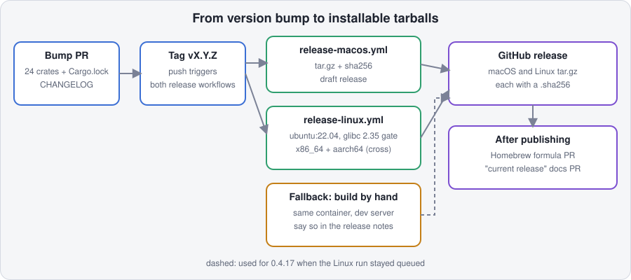

# The Linux package

A release builds one tarball per architecture, `fluxvm-<version>-linux-<x86_64|aarch64>.tar.gz` with a `.sha256`, in the
ubuntu:22.04 build container (`.github/workflows/release-linux.yml`). Nothing is compiled on a node: the same files are
installed everywhere, by `scripts/install.sh` ([install.md](install.md)), by hand (below), or by the pull installer
`fluxvm-bootstrap`, which defaults to tarball mode ([fleet-install.md](fleet-install.md)).

> **Releases are tarball-only.** Since #739 no release builds, verifies or attaches a `.deb` or an `.rpm`, and the packaging
> scripts for them (`scripts/package-linux-pkgs.sh`, `packaging/nfpm.yaml`, `packaging/deb/`, and their tests) have been removed
> from the tree. Releases up to and including 0.4.21 carry the packages (0.4.21 has both for x86_64 and aarch64); build them from
> that tag if you need the old scripts.

## What a release attaches

| Asset | Built by |
|---|---|
| `fluxvm-<version>-linux-x86_64.tar.gz`, `fluxvm-<version>-linux-aarch64.tar.gz`, each with a `.sha256` | `release-linux.yml` (the aarch64 build is a cross build and marked experimental) |
| `fluxvm-<version>-macos-arm64.tar.gz` and its `.sha256` | `release-macos.yml` |
| `fluxvm-k8s-<version>.yaml` and its `.sha256`, the Kubernetes manifest with the image digest pinned | `publish-image.yml` ([container-image.md](container-image.md)) |

0.4.19 was published without any Linux asset (see [Releasing](#releasing-the-guestkit-pin)); use 0.4.20 or later.

## How a release becomes a tarball



A version-bump PR (every crate, `Cargo.lock`, the changelog) is merged, then the tag is pushed. The tag starts `release-macos.yml`
(a tarball attached to a draft release) and `release-linux.yml`. The Linux workflow runs these jobs:

1. **plan**: the architecture matrix. x86_64 is built natively; aarch64 is cross-built on x86_64 and marked experimental, so a failed
   aarch64 build does not stop the x86_64 tarball or the release, and a green run is not proof the aarch64 tarball exists.
2. **package** (in `ubuntu:22.04`): reads the guestkit tag from `packaging/guestkit.ref`, checks guestkit out at it and runs
   `scripts/check-guestkit-pin.sh` (see [Releasing](#releasing-the-guestkit-pin)), builds with `scripts/package-linux.sh`, then runs
   the glibc floor gate (`scripts/check-glibc-floor.sh <dir> 2.35`). A second, informational probe (`continue-on-error`) checks
   whether the binaries would also run on glibc 2.34 (EL9).
3. **verify**: unpacks the tarball in a clean `ubuntu:22.04` container (the aarch64 one under qemu), checks that `fluxctl`,
   `fluxvm-hypervisor` and `fluxvm-agent` have no missing libraries and that `fluxctl --version` runs, then attaches the tarball and
   its `.sha256` to the release (created as a draft if it does not exist, so nothing is published until someone publishes it).
4. **publish**: writes the SBOM, attests build provenance for the tarballs and, when the `FLUXVM_RELEASE_KEY` secret is set,
   signs a release manifest and channel file for the pull installer (default channel `canary` at 100 %). With the `MIRROR_S3_URI`
   variable it syncs the mirror, channel files last.

Publishing is followed by the Homebrew formula PR and the "current release" docs PR.

If the Linux run cannot start, the same tarball can be built by hand from the tag in the same `ubuntu:22.04` container:
`scripts/package-linux.sh`, then `scripts/check-glibc-floor.sh <dir> 2.35`, then attach `target/package/*.tar.gz` and `*.sha256` with
`gh release upload`, and say in the release notes that it was built by hand. For 0.4.17 the Linux x86_64 and aarch64 packages
(at that time tarball, `.deb` and `.rpm`) were built this way on a self-hosted server, checked (deb in Ubuntu 22.04, rpm in
Fedora 43, each on its own architecture) and attached to the release.

## Installing

Per architecture, a release carries the tarball and its `.sha256`. Example for 0.4.21 on x86_64 (use `aarch64` on ARM; 0.4.21 is
the last release that also carries `.deb` and `.rpm`):

```bash
V=0.4.21; B=https://github.com/zyvorai/zyvor-fluxvm/releases/download/v$V
curl -fsSLO $B/fluxvm-$V-linux-x86_64.tar.gz && curl -fsSLO $B/fluxvm-$V-linux-x86_64.tar.gz.sha256
sha256sum -c fluxvm-$V-linux-x86_64.tar.gz.sha256 && tar -xzf fluxvm-$V-linux-x86_64.tar.gz
cd fluxvm-$V-linux-x86_64 && sha256sum -c --quiet MANIFEST.sha256     # every unpacked file against the package's own hashes
```

Unpacking installs nothing. Either run `scripts/install.sh` (rootless, under `~/.local`; it prints the root steps for the service)
or place the files yourself. By hand, as root, from the unpacked directory:

```bash
sudo install -m 0755 bin/fluxctl /usr/local/bin/fluxctl            # the unit's ExecStart is /usr/local/bin/fluxctl
sudo ln -sfn fluxctl /usr/local/bin/fluxvm
sudo mkdir -p /usr/lib/fluxvm && sudo cp -r lib/bpf /usr/lib/fluxvm/   # the BPF objects the daemon loads by default
sudo install -m 0644 share/config.example.toml /etc/fluxvm.toml       # only if you have none; edit it first
sudo install -m 0644 share/systemd/fluxvm.service /etc/systemd/system/fluxvm.service
sudo systemctl daemon-reload && sudo systemctl enable --now fluxvm
```

The daemon looks for its eBPF objects in `/usr/lib/fluxvm/bpf` unless the config names others (`crates/fluxvm-core/src/config.rs`),
and the unit runs `/usr/local/bin/fluxctl`. Copy the other binaries you use from `bin/` the same way. This block was written from
the manifest and the unit, not run end to end on a fresh host. `scripts/install.sh --service` prints the `fluxctl`, config and unit steps and the
`systemctl` line, but not the BPF directory (a gap in that script, not in the package).

Needs glibc 2.35 or newer: Ubuntu 22.04+, Debian 12+, Fedora and RHEL-family 10. EL9 (glibc 2.34) is not supported; the glibc
gate in the release job is what enforces the floor. The aarch64 build is still labelled experimental in the workflow.

### Upgrading

- **`scripts/install.sh`** keeps every unpacked version under `~/.local/share/fluxvm/<version>` and repoints `current`; run it again for
  a newer version, or with `--version` to roll back ([install.md](install.md#upgrade-pin-roll-back-uninstall)). It never writes the
  service, so after an upgrade copy the new `bin/fluxctl` over `/usr/local/bin/fluxctl` and `systemctl restart fluxvm` yourself.
- **`fluxvm-bootstrap`** (the pull installer; mirror, signatures and waves in [fleet-install.md](fleet-install.md)) defaults to
  `INSTALL_MODE=tarball`: it unpacks to `/opt/fluxvm/<version>`, flips `/opt/fluxvm/current`, links each `bin/*` into
  `/usr/local/bin`, copies `share/systemd/*.service` to `/etc/systemd/system`, links `lib/bpf` at `/usr/lib/fluxvm/bpf`, restarts
  `fluxvm.service` when it is enabled, waits for the new version to answer and rolls back by itself when it does not.
  `/etc/fluxvm.toml` and `/var/lib/fluxvm` are not touched. The unit uses `KillMode=process`, so a restart leaves running VMs alone.
- **A node installed from a `.deb` or `.rpm`** (0.4.21 or earlier): the packages put binaries in `/usr/bin`, the tarball paths above use
  `/usr/local/bin`, and a release after 0.4.21 has no `.deb`/`.rpm`, and `fluxvm-bootstrap` now refuses `INSTALL_MODE=deb|rpm` (`INSTALL_MODE=... is no longer supported`).
  The packaged unit is replaced by the one in `/etc/systemd/system`. To move such a node: keep `/etc/fluxvm.toml` and `/var/lib/fluxvm`,
  remove the package (`apt-get remove fluxvm` / `dnf remove fluxvm` keep both), then install the tarball as
  above or run `fluxvm-bootstrap` with `INSTALL_MODE` unset. Not tested: a package-to-tarball migration on a real node, and in particular
  whether a leftover `/usr/lib/fluxvm/bpf` directory from the package is replaced (the bootstrap uses `ln -sfn`, which would
  create the link inside an existing directory), so remove that directory first.

## What is in it

`packaging/files.txt` lists every file, one per line, and `scripts/package-linux.sh` builds exactly that. It fails when a
required file is missing, so the package cannot silently lose a binary. The core group:

| Path in the package | What |
|---|---|
| `bin/fluxctl` (+ `bin/fluxvm` link) | CLI and the daemon (`fluxctl serve`) |
| `bin/fluxvm-hypervisor` | the in-tree FluxVM hypervisor |
| `bin/fluxvm-agent` | fleet central and the per-node heartbeat client |
| `bin/fluxvm-kube`, `bin/kubectl-fluxvm` | the Kubernetes operator and its kubectl plugin |
| `bin/fluxvm-microvm` | the Kubernetes MicroVM controller and node agent |
| `bin/fluxvm-guard` | VMM Guard CLI |
| `lib/bpf/*.bpf.o` | the BPF objects the daemon loads, built for the package's architecture (installed to `/usr/lib/fluxvm/bpf/`) |
| `share/guest/fluxvm-guest-agent` | the static (musl) guest agent, injected into guest images of any distro |
| `share/config.example.toml`, `share/systemd/fluxvm.service` | config template and the one hardened unit (`ExecStart=/usr/local/bin/fluxctl --config /etc/fluxvm.toml serve`, `KillMode=process`) |
| `bin/fluxvm-bootstrap`, `share/systemd/fluxvm-bootstrap.{service,timer}`, `share/bootstrap.conf.example` | the pull installer, its timer (every 6 h, off until enabled) and a config template ([fleet-install.md](fleet-install.md)) |
| `share/systemd/fluxvm-agent.service`, `share/agent.env.example` | unit and environment template for `fluxvm-agent` |
| `share/release.pub`, `LICENSE` | the release public key and the license; both optional in the manifest (`packaging/release.pub` is not in the tree today, so the key is not in the tarball and a node needs `/etc/fluxvm/release.pub`) |
| `share/completions/` | bash, zsh and fish completions (native builds only) |
| `MANIFEST.sha256` | a sha256 of every other file, so what was unpacked can be checked |

Not packaged yet (the manifest reserves a group `extras` for them; it has no entries today): the Sentinel / runtime-intelligence daemons and their C loaders
(they need libbpf at run time), the fluxmesh agents, the containerd shim and container agent, `fluxvm-procbox`. They need a
decision on a separate package and on the runtime libraries it declares.

The layout keeps `bin/`, `share/config.example.toml` and `share/systemd/fluxvm.service` where `scripts/install.sh`
expects them; everything else is added next to them.

## Distribution support

The tarball needs glibc 2.35 or newer, the floor of the ubuntu:22.04 build container. EL10 and Fedora are newer than that and
unpack and run it; EL9 ships glibc 2.34, so the binaries do not run there yet and, with no package manager in the way, nothing
prints a friendly message (they die with `GLIBC_2.35 not found`). The release job runs `check-glibc-floor.sh ... 2.34` as an
informational probe (`continue-on-error`); if it passes, the floor can be lowered (the argument in the workflow), otherwise the
binaries would have to be built in a Rocky 9 container (follow-up). The SELinux policy for the host is not packaged;
`systemd/fluxvm-selinux-ensure.service` runs inside the Secure Containers guest, not on the host. Firecracker and Cloud Hypervisor are
pinned in `packaging/vendor.lock` (see below) but not bundled into the tarball.

## Pinned vendor binaries

`packaging/vendor.lock` pins Firecracker, Cloud Hypervisor, `ch-remote` and the Rust Hypervisor Firmware: version, per-arch
URL and SHA-256, one line each. `scripts/install-firecracker.sh --lock packaging/vendor.lock` and
`scripts/install-cloud-hypervisor.sh --lock packaging/vendor.lock` take everything from it and never call the GitHub API or
resolve "latest" (the binary, `ch-remote` and the firmware are all verified against the lock). Other forms:
`--version V --sha256 HEX` (pinned digest, URL built from the version, no API), `--from-file FILE` with one of those (use an
already downloaded archive, verified; Cloud Hypervisor applies it to the `cloud-hypervisor` binary only), and `--dry-run`
(print the plan, no network or install, any OS). The default with no flags is unchanged: latest release, digest from the API.

To bump a version, download each asset, hash it with `sha256sum`, edit the lines, and run `scripts/test-vendor-lock.sh`
(offline: format, completeness, flags) and `scripts/test-vendor-lock.sh --online` (downloads every asset and compares hashes).
The firmware release publishes no digest on GitHub, so its hash is trust-on-first-download.

## Testing

What runs where, after the change to tarball-only releases:

- `release-linux.yml` (release jobs): the glibc floor gate, the glibc 2.34 probe, and a smoke test that unpacks the tarball in a clean
  ubuntu:22.04 container (no missing libraries, `fluxctl --version`). It no longer installs a `.deb` or `.rpm`.
- `packaging-checks.yml` (CI on changes to `packaging/`, `scripts/`): `scripts/package-linux.sh --check-manifest` and the manifest tests,
  the pull-installer tests (`scripts/test-bootstrap.sh`, tarball mode only), shellcheck, and `scripts/test-vendor-lock.sh`.
- Not covered by any job: installing the tarball on a fresh host and starting the service, and the package-to-tarball migration above.

## Building and checking

```bash
scripts/package-linux.sh --check-manifest       # validate packaging/files.txt against the repo (any OS, no build)
scripts/package-linux.sh --version 0.4.21       # build, stage and tar (Linux; see the script header for requirements)
scripts/package-linux.sh --stage-only           # stop after staging: target/package/fluxvm-<ver>-linux-<arch>/
scripts/check-glibc-floor.sh target/package/fluxvm-0.4.21-linux-x86_64 2.35   # the compatibility gate
```

To add a file to the package, add a line to `packaging/files.txt`; `scripts/test-package-manifest.sh` and CI check the file.
A cross build (`--target aarch64-unknown-linux-gnu`) builds the BPF objects for arm64 with `FLUXVM_BPF_ARCH` and leaves
the completions out, because it cannot run the binaries it makes.

## Releasing: the guestkit pin

fluxvm builds against the sibling repo `zyvorai/guestkit` through a relative path (`crates/fluxvm-image` depends on
`../../../guestkit`, so the checkout must sit next to the fluxvm directory). Release builds check guestkit out at a fixed tag,
never its default branch, and three places must name the same version:

1. `packaging/guestkit.ref`: one tag, for example `v1.2.9` (the current pin; 0.4.20 and 0.4.21 are built with it).
2. `Cargo.lock`: the `guestkit` package's `version` (the tag without the `v`).
3. Every `.github/workflows/*.yml` step that checks out `zyvorai/guestkit` has `ref:` set to that tag (the workflows
   carry the comment `# packaging/guestkit.ref; checked by scripts/check-guestkit-pin.sh`). `release-linux.yml` reads the ref file
   instead of repeating the tag, and the checker accepts that form.

`scripts/check-guestkit-pin.sh [FLUXVM_DIR] [GUESTKIT_DIR]` checks, in order:

- `packaging/guestkit.ref` holds one `vX.Y.Z` tag and equals `Cargo.lock`'s guestkit version, else it fails ("bump both together").
- With `GUESTKIT_DIR`: that checkout is at the pinned tag. `actions/checkout` at a tag can leave a detached HEAD without the tag
  itself, so the script also accepts a HEAD that the remote's tag points at.
- With `GUESTKIT_DIR` (new in 0.4.21): **Cargo.lock drift.** The version strings can agree while the lock is still stale for guestkit's own
  dependencies: before 0.4.21 the lock pinned `evtx` 0.15.1 while guestkit 1.2.9 needs 0.12, so every `--locked` cargo command failed.
  The script now runs `cargo metadata --locked --format-version 1` in `FLUXVM_DIR` and fails when it cannot resolve. It needs `cargo` on
  `PATH` (without it this step is skipped silently) and the guestkit checkout at the relative path above. Set
  `CHECK_GUESTKIT_PIN_SKIP_CARGO=1` to skip it (what `scripts/test-check-guestkit-pin.sh` does, because its fixtures are not a real
  workspace).
- Every workflow that checks guestkit out pins that ref (the count of `repository: zyvorai/guestkit` lines must equal the count of pinned
  `ref:` lines in each file).

Where it runs: `devops-gates.yml` runs `scripts/check-guestkit-pin.sh .` (the version and workflow checks only: no guestkit directory is
given, so no cargo step) and the checker's own tests; `release-linux.yml` runs it with the guestkit checkout before building (the cargo
step included); `cargo-update.yml` runs it after `cargo update`. Run it yourself before merging, with the checkout, to include the lock check:

```bash
scripts/check-guestkit-pin.sh .                    # version and workflow checks only
scripts/check-guestkit-pin.sh . ../guestkit        # plus the checkout tag and the Cargo.lock drift check
```

This is what broke 0.4.19: the ref said `v1.2.6` while `Cargo.lock` recorded 1.2.9, both Linux package jobs failed, and the release went out
without Linux packages (fixed for 0.4.20 in #731). 0.4.21 then found a stale lock that the version comparison could not see (#737).

To bump guestkit, in one PR: edit `packaging/guestkit.ref`, refresh `Cargo.lock` (`cargo metadata`, without `--locked`; not `cargo update`,
which moves every dependency) and change every workflow `ref:`; run the checker with the checkout before merging.

Before tagging, check that the pin check passes on the release commit. After the Linux run, check that the release carries the
tarball and `.sha256` for **both** architectures (the aarch64 build is experimental and can fail without failing the run) and that
the macOS tarball is attached. `.deb` and `.rpm` are no longer part of the checklist; releases up to 0.4.21 have them.
